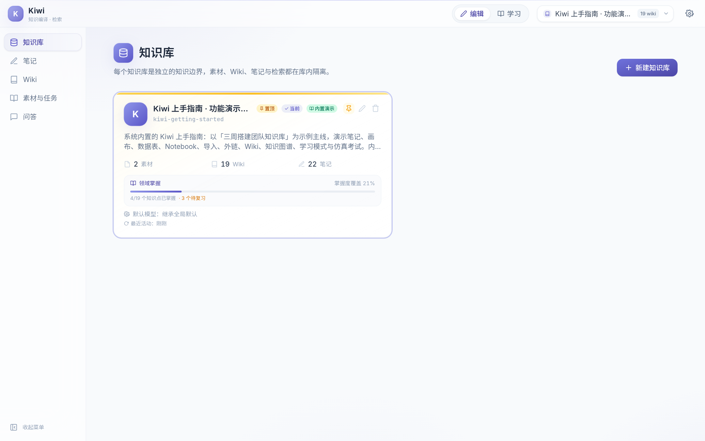
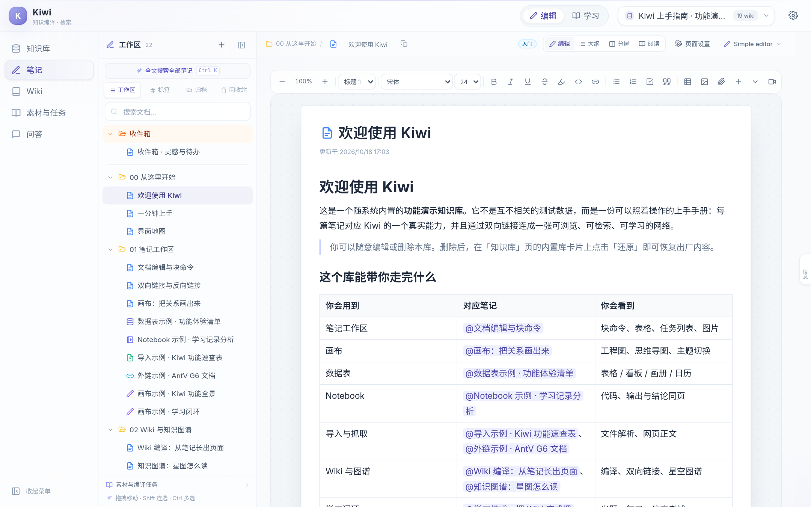
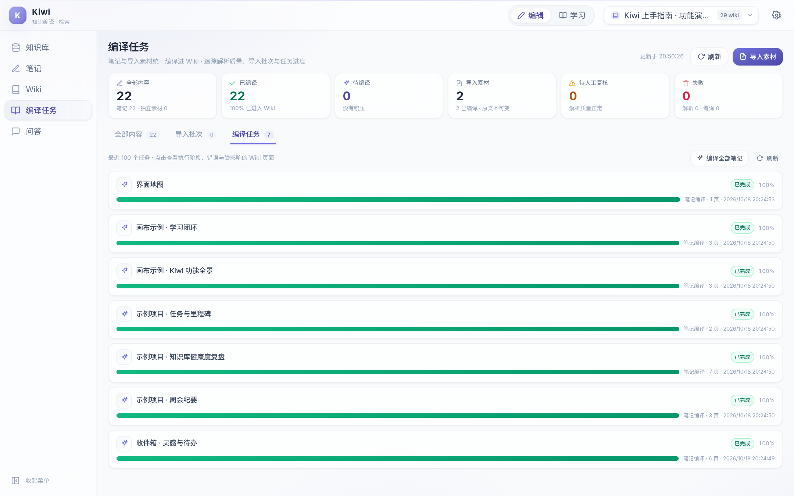
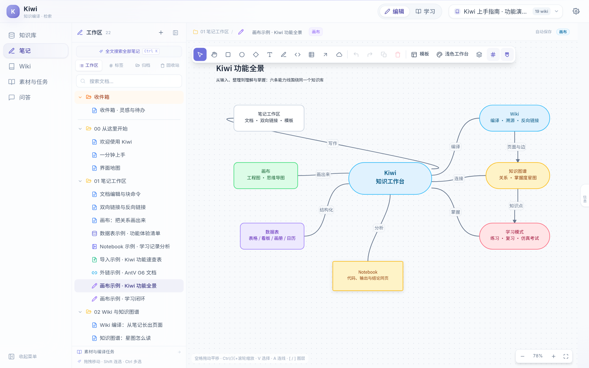
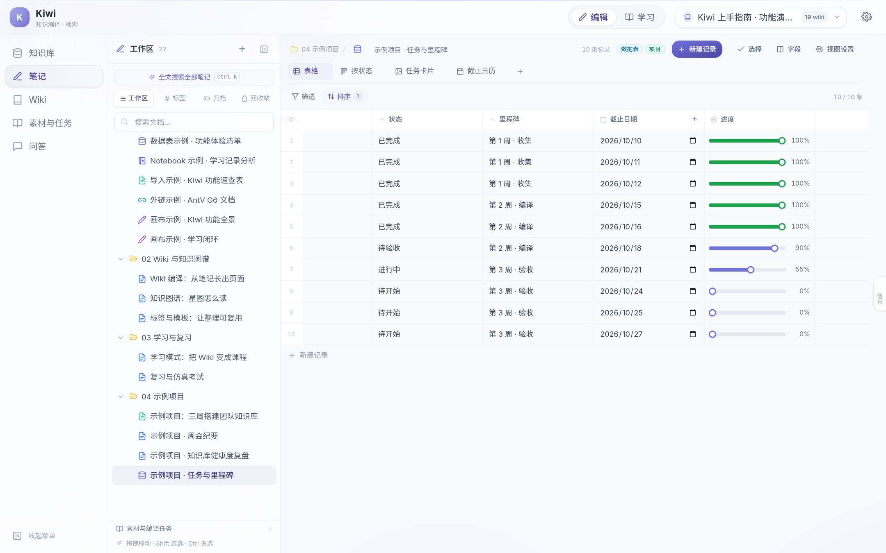
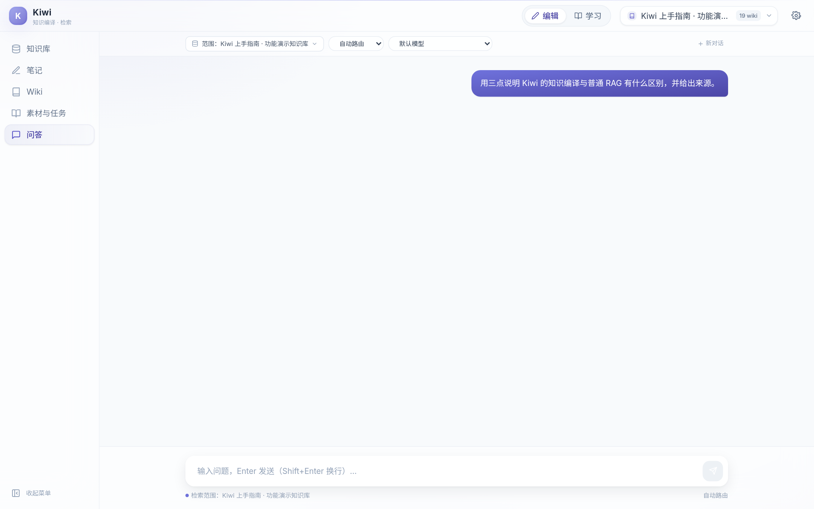
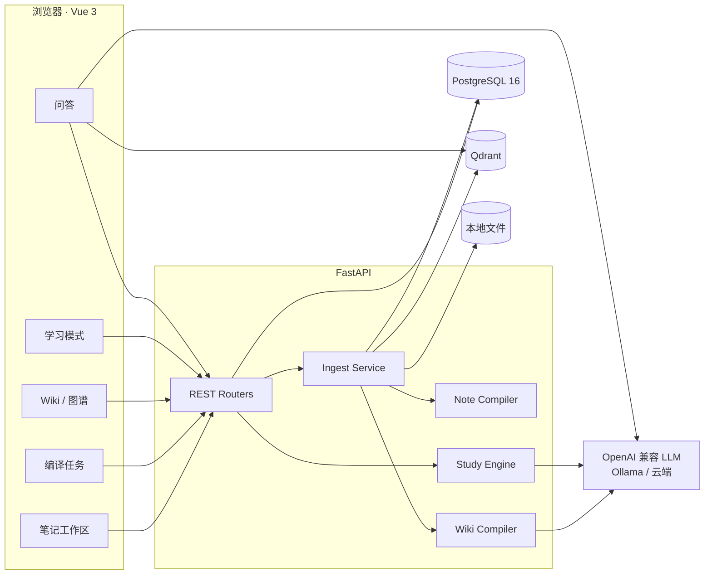

<p align="center">
  
</p>

<h1 align="center">Kiwi · 知识编译与学习系统</h1>

<p align="center">
  把零散笔记与素材，编译成一张可以阅读、追问、练习和复习的知识网络。
</p>

<p align="center">
  
  
  
  
  
  
</p>

---

## 简介

大多数笔记工具止步于「存下来」，大多数 RAG 工具止步于「问一句、答一句」。

Kiwi 把两者接了起来：文档、PDF、网页、数据表、画布和 Notebook 先成为可编辑的**笔记**；再由编译流水线抽取概念、合并页面、建立引用，长成一套结构化的 **Wiki**；最后交给学习模式，生成学习计划、练习题、间隔复习和仿真考试。

知识不是一次性问答的燃料，而是可以反复生长、逐步校准的资产。Kiwi 面向单用户、本地优先，数据默认留在自己的机器上。

---

## 核心能力

- **统一的笔记工作区** — 文档、数据表（表格 / 看板 / 画册 / 日历）、导入、外链、画布、Notebook 共用一套目录、标签、模板、双向链接与反向链接。
- **有结构的编译流水线** — 所有笔记和独立素材都能编译进 Wiki；LLM 按 Schema 新建或增量更新页面，自动重建 `[[slug]]` 引用边与相关边。
- **可阅读、可追溯的 Wiki** — 页面类型、版本、来源、批注与健康检查齐全；每个页面都能回到编译它的笔记与素材，也可一键全量重建。
- **知识图谱** — 星图式节点关系，按被引次数缩放节点，支持类型筛选、聚焦与拖拽浏览。
- **学习闭环** — 学习画像 → 学习计划 → 渐进练习 → 间隔重复 → 仿真考试 → 错题本，知识点与 Wiki 页面通过 slug 持续关联。
- **有出处的问答** — 基于笔记与 Wiki 的混合检索，回答附带引用；高质量回答可回写为 Wiki 综合页。
- **本地优先的基础设施** — PostgreSQL + Qdrant；兼容 OpenAI 协议的任意模型（本地 Ollama 或云端 API）；API Key 加密存储。

<p align="center">
  
  <br />
  <sub>笔记工作区：目录树、块编辑器、双向链接、模板与标签。</sub>
</p>

---

## 界面预览

<table>
  <tr>
    <td width="50%"><br /><sub>编译任务：笔记与素材统一编译、逐任务查看进度</sub></td>
    <td width="50%"><br /><sub>知识图谱：引用关系与页面类型一览</sub></td>
  </tr>
  <tr>
    <td><br /><sub>画布：工程图、思维导图与主题切换</sub></td>
    <td><br /><sub>数据表：多视图与进度、评分等字段</sub></td>
  </tr>
  <tr>
    <td><br /><sub>学习模式：掌握度、计划与复习队列</sub></td>
    <td><br /><sub>问答：引用可溯源，结论可回写 Wiki</sub></td>
  </tr>
</table>

---

## 系统架构



| 层 | 选型 |
|---|---|
| 前端 | Vue 3.5 · TypeScript · Vite · Pinia · Tailwind CSS · TipTap · AntV G6 · CodeMirror · Mermaid · KaTeX |
| 后端 | FastAPI · SQLAlchemy 2（async） · Alembic · Pydantic 2 |
| 存储 | PostgreSQL 16 · Qdrant · 本地文件系统 |
| 检索 | fastembed（默认 `BAAI/bge-small-zh-v1.5`） · 混合检索 |
| 模型 | 任意 OpenAI 兼容接口；本地推荐 Ollama |
| 运行 | Docker Compose（PG / Qdrant） + uv + Node.js |

---

## 快速开始

需要 Python 3.12、[uv](https://docs.astral.sh/uv/)、Node.js ≥ 20、Docker。

```bash
git clone https://github.com/LsWGG/Kiwi.git
cd Kiwi
./run.sh
```

`run.sh` 会自动生成 `.env`、启动 PostgreSQL 与 Qdrant、执行数据库迁移、安装依赖并拉起前后端。启动后访问 **http://localhost:5173**，在设置中填写任意 OpenAI 兼容模型即可开始使用。

首次打开时，Kiwi 会注入内置的 **「Kiwi 上手指南 · 功能演示知识库」**：22 篇笔记、29 个 Wiki 页面、完整的学习与考试数据，全部围绕「三周搭建团队知识库」这一条主线展开。可自由修改或删除，删除后可在知识库页面还原。

---

## 设计理念

**笔记是唯一事实来源。** Wiki 是编译产物，可以随时删除重建；原始内容始终保留在笔记与素材里。

**结构由 Schema 约束。** 页面类型、命名、引用与质量标准都可配置；人工编辑过的页面不会被自动编译覆盖。

**学习直接长在 Wiki 上。** 知识点、题目和复习记录通过 slug 关联页面；页面重建后，关联会自动恢复，不会留下另一套脱节的学习内容。

---

## 项目结构

```text
Kiwi/
├── backend/
│   ├── app/
│   │   ├── routers/          # KB、笔记、数据表、导入、Wiki、搜索、问答、学习
│   │   ├── services/         # 摄入、编译、检索、学习引擎、内置演示资产
│   │   └── db/               # 模型与会话
│   ├── alembic/              # 数据库迁移
│   └── pyproject.toml
├── frontend/
│   └── src/
│       ├── views/            # 知识库、笔记、编译任务、Wiki、学习、问答、设置
│       ├── components/       # 编辑器、画布、图谱、数据表、笔记面板
│       └── stores/           # Pinia 状态
├── docs/
│   ├── assets/screenshots/   # README 截图
│   └── design/               # 设计文档
├── docker-compose.yml        # PostgreSQL + Qdrant
├── run.sh                    # 一键启动（开发模式）
└── .env.example
```

更多设计细节见 [docs/design/kiwi-design-v1.2.md](docs/design/kiwi-design-v1.2.md)。

---

<p align="center">
  <sub>Kiwi · 让笔记不只是被保存，而是被读懂、被连接、被学会。</sub>
</p>
