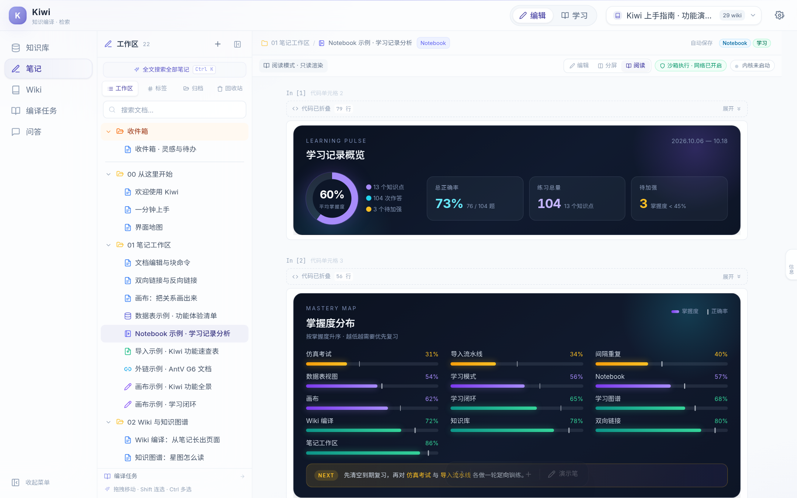
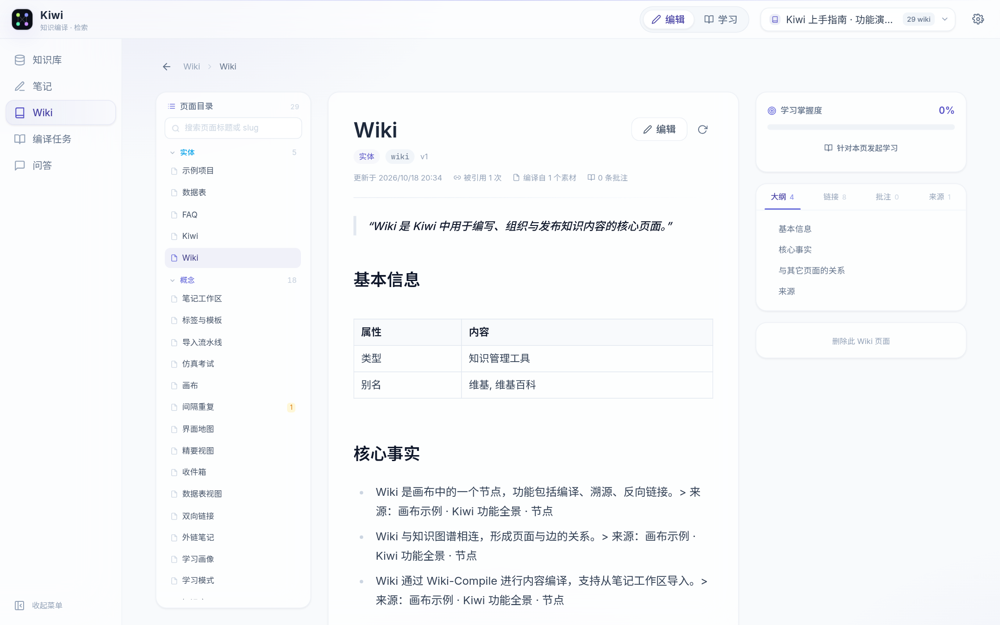
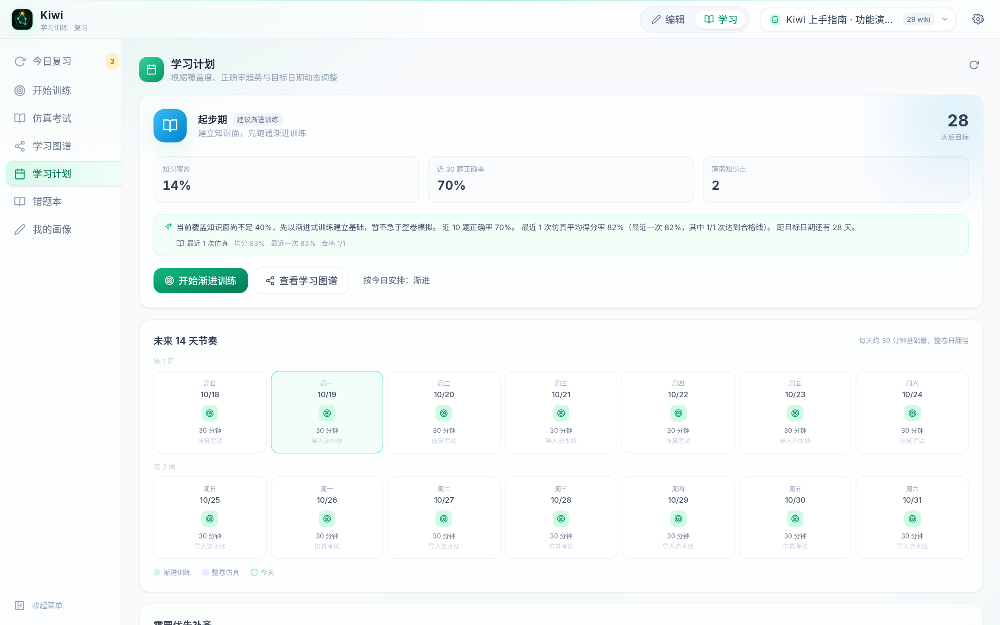
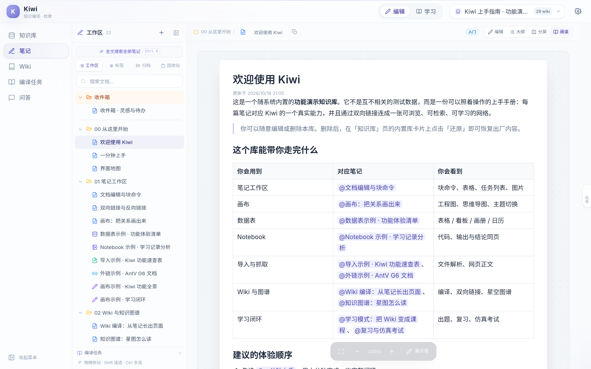
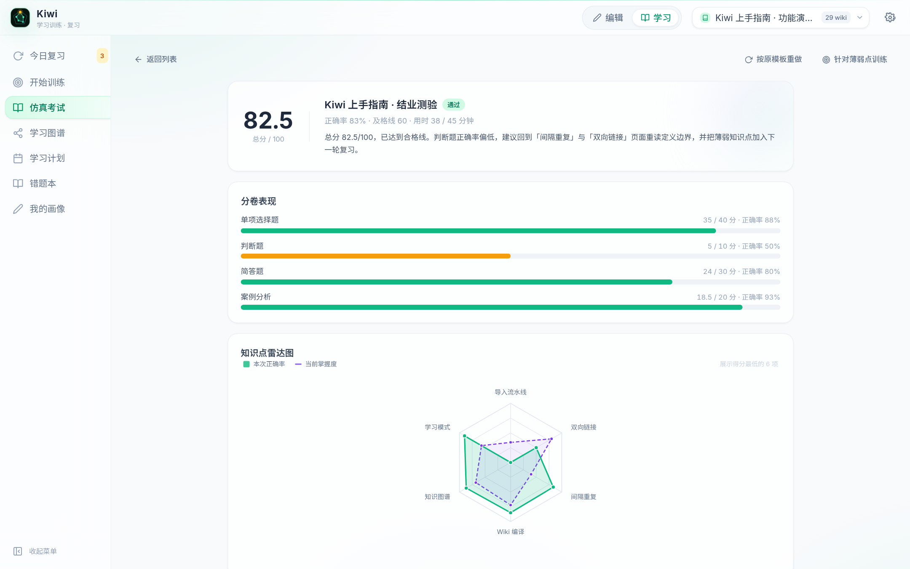
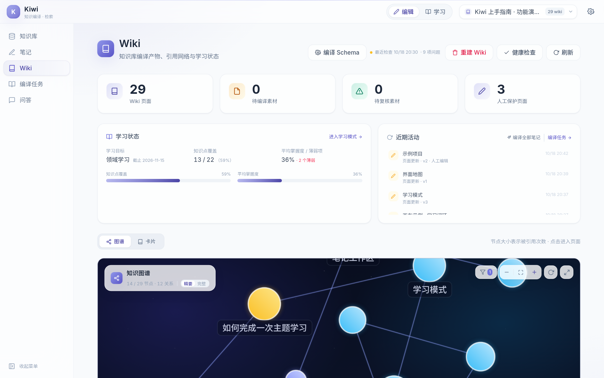
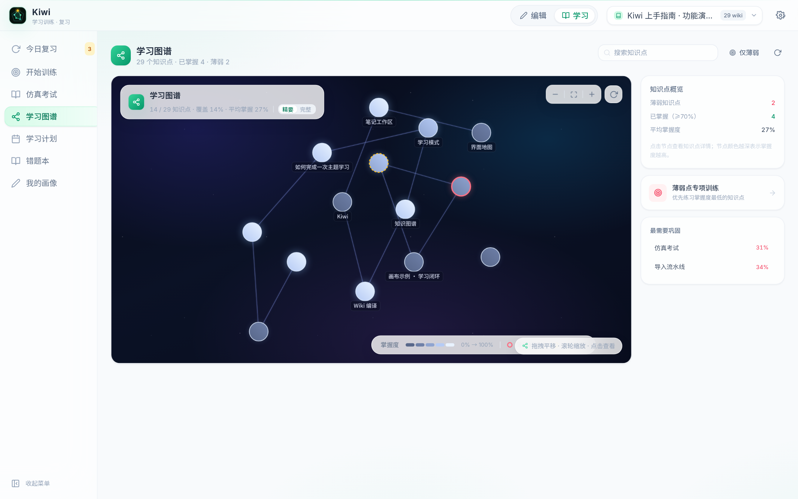

<p align="center">
  
</p>

<h1 align="center">Kiwi · 知识编译与学习系统</h1>

<p align="center">
  把笔记编译成知识，把知识变成掌握度。<br />
  <a href="https://lswgg.github.io/Kiwi/">产品主页</a> · <strong>简体中文</strong> · <a href="README.en.md">English</a>
</p>

<p align="center">
  
  
  
  
  
  
</p>

---

Kiwi 不是另一个「把东西存起来」的笔记软件。

文档、PDF、网页、数据表、画布与 Notebook 在这里是原材料：编译流水线把它们拆成概念、合并成相互引用的 Wiki 页面，并为每一条结论保留来源。随后，同一份知识进入学习引擎——画像、训练、间隔重复、仿真考试，掌握度再回写到页面。

大多数工具在「记下来」处结束。Kiwi 继续追问：**你怎么知道自己真的学会了？**

## 为什么不同

- **知识是编译出来的。** 不靠手工维护目录，而由 Schema、增量编译与引用关系让结构自己长出来。
- **图谱也是掌握度地图。** 页面引用、笔记关联、薄弱点与掌握度共用一套坐标；既看知识怎么连，也看哪里还没学会。
- **学习闭环长在知识库里。** 出题、复习、考试与掌握度更新都在库内完成，不需要把内容导出到另一个工具。
- **本地优先，模型可替换。** PostgreSQL + Qdrant 单机运行，兼容任意 OpenAI 协议模型；数据与推理都留在自己的机器上。

## 核心能力

- **笔记工作区**：文档、数据表、导入、外链、画布、Notebook 共用目录、标签、模板与双向链接。
- **三种编辑模式**：同一份 Markdown 在 Simple、Notion-like 与 DOCX 编辑器间切换，专注写作、块级组织与正式排版各取所需。
- **可执行代码块**：Python 在 bubblewrap 沙箱中运行，输出与退出码以块的形式留在正文；HTML / JS 在隔离 iframe 中预览。
- **编译任务**：所有笔记与素材统一编译进 Wiki，追踪解析质量、任务进度与受影响页面。
- **结构化 Wiki**：Schema 驱动、增量更新、来源引用、健康检查与一键重建。
- **知识星图**：星图式浏览页面关系，节点大小反映被引次数。
- **学习闭环**：画像 → 计划 → 渐进练习 → 间隔重复 → 仿真考试 → 错题本。
- **有出处的问答**：混合检索 Wiki 与原文，回答可溯源，也可回写为新页面。

## 界面

<table>
  <tr>
    <th width="50%" align="left">编辑模式 · 编译与组织</th>
    <th width="50%" align="left">学习模式 · 练习与检验</th>
  </tr>
  <tr>
    <td><br /><sub>结构化 Wiki：目录、大纲与反向链接</sub></td>
    <td><br /><sub>学习计划：按掌握度动态排程</sub></td>
  </tr>
  <tr>
    <td><br /><sub>笔记工作区：目录树、双链与上手引导</sub></td>
    <td><br /><sub>仿真考试：分卷表现与知识点雷达</sub></td>
  </tr>
  <tr>
    <td><br /><sub>知识星图：概念关系与被引次数</sub></td>
    <td><br /><sub>学习图谱：掌握度分布与薄弱点</sub></td>
  </tr>
</table>

## 技术栈

Vue 3.5 · TypeScript · Vite · Pinia · Tailwind CSS · TipTap · AntV G6  
FastAPI · SQLAlchemy 2 · PostgreSQL 16 · Qdrant · fastembed  
Docker Compose · uv · Node.js

## 启动

需要 Python 3.12、uv、Node.js ≥ 20 与 Docker：

```bash
git clone https://github.com/LsWGG/Kiwi.git
cd Kiwi
./run.sh
```

访问 http://localhost:5173 默认进入产品门户；应用工作区位于 http://localhost:5173/kbs，在设置中填写任意 OpenAI 兼容模型即可使用。若运行环境无法加载本地向量模型，可在 **设置 → 向量模型** 切换为线上 embedding 接口。

首次启动会注入内置的 **「Kiwi 上手指南 · 功能演示知识库」**，包含 22 篇笔记、29 个 Wiki 页面以及完整的学习与考试数据，可自由修改、删除或还原。

## Docker 部署

生产环境使用独立的 Compose 文件，默认全部采用非常规端口：Web `18473`、API `18474`、PostgreSQL `15432`、Qdrant `16333 / 16334`。

```bash
./deploy.sh
```

脚本会自动生成 `.env.prod`、随机密码与 Fernet 密钥，构建前后端镜像并完成数据库迁移。访问 `http://<host>:18473` 即可。

端口调整、数据备份、升级、沙箱权限与排障见 [docs/DEPLOY.md](docs/DEPLOY.md)。版本演进见 [版本迭代记录](docs/CHANGELOG.md)。

---

## 版权声明

Copyright © 2026 LsWGG. 保留所有权利。

未经授权，不得复制、修改、分发或将本项目用于商业用途。
